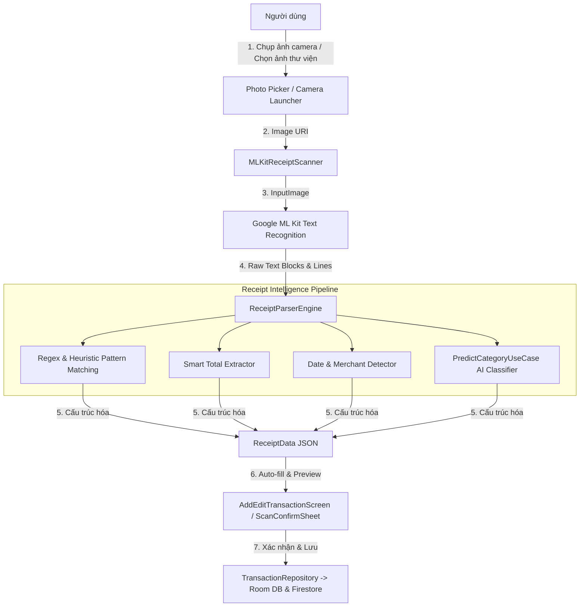

# 🧾 Kế hoạch Nâng cấp: Quét Hóa đơn Tự động bằng Google ML Kit (Receipt OCR to JSON)

Tài liệu này vạch ra kiến trúc, luồng xử lý và kế hoạch triển khai chi tiết từng bước cho tính năng: **Chụp / Tải ảnh hóa đơn thanh toán (Bill) -> Nhận diện chữ bằng Google ML Kit on-device -> Trích xuất dữ liệu có cấu trúc dạng JSON (Số tiền, Cửa hàng, Ngày, Danh mục, Chi tiết món) -> Tự động điền và tạo Transaction vào ứng dụng.**

---

## 🏗️ 1. Kiến trúc Tổng thể (Architecture Overview)



---

## 📋 2. Cấu trúc Dữ liệu JSON (Target JSON Schema)

Khi Google ML Kit quét xong ảnh, bộ phân tích (`ReceiptParserEngine`) sẽ chuyển đổi raw text thành định dạng JSON chuẩn như sau:

```json
{
  "merchantName": "Highlands Coffee",
  "totalAmount": 79000.0,
  "currency": "VND",
  "date": "2026-10-26",
  "category": "Ăn uống",
  "type": "expense",
  "paymentMethod": "Tiền mặt / Thẻ / Chuyển khoản",
  "items": [
    {
      "name": "Phin Sữa Đá (L)",
      "quantity": 1,
      "price": 39000.0
    },
    {
      "name": "Trà Sen Vàng (M)",
      "quantity": 1,
      "price": 40000.0
    }
  ],
  "rawText": "HIGHLANDS COFFEE\nHD: 12345\nPhin Sua Da (L) 1 39.000\nTra Sen Vang (M) 1 40.000\nTong cong: 79.000 VND\nNgay: 26/10/2026\nCam on quy khach!",
  "confidenceScore": 0.94
}
```

---

## 🛠️ 3. Chi tiết Các Bước Triển Khai (Phases)

### 🔹 Phase 1: Thêm Thư viện & Cấu hình Quyền (Dependencies & Permissions)

1. **Gradle Dependencies**:
   - Sử dụng Google ML Kit Text Recognition on-device (chạy 100% offline, miễn phí, bảo mật riêng tư, không gửi ảnh lên server):
     ```kotlin
     // libs.versions.toml
     mlkit-text-recognition = "16.0.1" // com.google.mlkit:text-recognition:16.0.1
     ```
2. **Camera & FileProvider trong `AndroidManifest.xml`**:
   - Cung cấp `FileProvider` để cấp quyền tạm thời cho Camera chụp ảnh lưu vào cache directory:
     ```xml
     <provider
         android:name="androidx.core.content.FileProvider"
         android:authorities="${applicationId}.fileprovider"
         android:exported="false"
         android:grantUriPermissions="true">
         <meta-data
             android:name="android.support.FILE_PROVIDER_PATHS"
             android:resource="@xml/file_paths" />
     </provider>
     ```
   - Khai báo file XML `app/src/main/res/xml/file_paths.xml` trỏ vào `cache-path`.
3. **Android Photo Picker**:
   - Sử dụng `ActivityResultContracts.PickVisualMedia()` cho phép người dùng chọn ảnh từ Gallery mà **không cần xin quyền READ_MEDIA_IMAGES / READ_EXTERNAL_STORAGE** (chuẩn Android hiện đại).

---

### 🔹 Phase 2: Domain Model & Bộ Phân Tích Chữ (Receipt Parser Engine)

1. **Domain Models**:
   - `ReceiptData.kt`: Chứa các trường `merchantName`, `totalAmount`, `date`, `category`, `items`, `rawText`, `confidenceScore`.
   - `ReceiptItem.kt`: `name: String`, `quantity: Int`, `unitPrice: Double`, `totalPrice: Double`.
2. **Bộ Nhận diện Text (`ReceiptScannerService`)**:
   - Interface trừu tượng hóa việc OCR từ `Uri` hoặc `Bitmap`:
     ```kotlin
     interface ReceiptScannerService {
         suspend fun scanReceipt(imageUri: Uri): Result<ReceiptData>
     }
     ```
3. **Thuật toán Trích xuất Thông minh (`ReceiptParserEngine`)**:
   - **Nhận diện Tổng tiền (Total Amount)**:
     - Regex quét các từ khóa: `Tổng cộng`, `Tổng tiền`, `Thanh toán`, `TOTAL`, `GRAND TOTAL`, `AMOUNT DUE`, `Cần thanh toán`.
     - Tìm số tiền lớn nhất hoặc số tiền nằm cùng dòng/dòng kế tiếp với từ khóa tổng tiền.
     - Xử lý các định dạng dấu phân cách: `79.000`, `79,000`, `79000đ`, `79.000 VND`, `$79.00`.
   - **Nhận diện Ngày tháng (Date)**:
     - Regex tìm ngày: `dd/MM/yyyy`, `dd-MM-yyyy`, `yyyy-MM-dd`, `dd/MM/yy`.
   - **Nhận diện Tên Cửa hàng (Merchant)**:
     - Lấy các dòng văn bản đầu tiên của hóa đơn (thường có kích thước font chữ lớn nhất hoặc nằm ở đầu block).
   - **Nhận diện Danh mục (Category)**:
     - Tự động map từ khóa mặt hàng sang Danh mục có sẵn trong app (ví dụ: `cafe`, `trà`, `cơm`, `phở` -> `Ăn uống`; `siêu thị`, `vinmart`, `coopmart` -> `Mua sắm`).
     - Tận dụng `PredictCategoryUseCase` sẵn có trong ứng dụng.
   - **Chuyển đổi sang JSON String**:
     - Sử dụng Gson (`Gson().toJson(receiptData)`) để dễ dàng debug, hiển thị hoặc lưu trữ nếu cần.

---

### 🔹 Phase 3: ViewModel & State Management

1. **`ReceiptScanUiState`**:
   ```kotlin
   sealed interface ReceiptScanUiState {
       object Idle : ReceiptScanUiState
       object Scanning : ReceiptScanUiState
       data class Success(val receipt: ReceiptData, val jsonString: String) : ReceiptScanUiState
       data class Error(val message: String) : ReceiptScanUiState
   }
   ```
2. **`ReceiptScannerViewModel`** (hoặc tích hợp vào `TransactionViewModel`):
   - Quản lý trạng thái quét, ảnh tạm thời, và phát sinh giao dịch mới.
   - Hàm `scanImage(uri: Uri)` chạy trên `Dispatchers.Default`.
   - Hàm `applyReceiptToTransaction(receipt: ReceiptData)` tự động điền form giao dịch.

---

### 🔹 Phase 4: Giao diện Người dùng (UI/UX Jetpack Compose)

1. **Điểm kích hoạt (Entry Points)**:
   - **Nút Scan trên Màn hình Thêm Giao Dịch (`AddEditTransactionScreen`)**:
     - Thêm icon camera/hóa đơn trên thanh công cụ `TopAppBar` hoặc cạnh ô nhập số tiền với tooltip *"Quét hóa đơn"*.
   - **Nút Scan Nhanh trên `TransactionsScreen`**:
     - Nút Action Bar hoặc Floating Action Button phụ: *"Quét bill thanh toán"*.
2. **Bộ chọn Nguồn ảnh (Image Source Dialog / Sheet)**:
   - Modal BottomSheet hiện đại cho phép chọn:
     - 📸 **Chụp ảnh mới** (mở Camera hệ thống qua URI FileProvider).
     - 🖼️ **Chọn từ thư viện** (mở Photo Picker hệ thống).
3. **Thẻ Duyệt & Xem trước Kết quả Hóa đơn (`ReceiptScanPreviewSheet`)**:
   - Hiển thị ảnh hóa đơn thu nhỏ kèm hiệu ứng scan (shimmering scanner bar).
   - Bảng xem trước dữ liệu nhận diện được:
     - **Tên cửa hàng**: Highlands Coffee (có thể sửa).
     - **Tổng tiền**: 79.000 ₫ (nổi bật, rõ ràng).
     - **Ngày**: 26/10/2026.
     - **Danh mục gợi ý**: Ăn uống (kèm icon).
     - **Danh sách món**: Preview nhanh danh sách các mặt hàng bóc tách được.
   - Tab mở rộng **"Xem JSON"**: Hiển thị code JSON format đẹp mắt để người dùng kiểm tra cấu trúc dữ liệu.
   - Nút **"Áp dụng vào Giao dịch"** / **"Lưu ngay"**.

---

### 🔹 Phase 5: Kiểm thử Toàn diện & Xử lý Ngoại lệ (Testing & Edge Cases)

1. **Unit Tests**:
   - Test regex bóc tách tổng tiền với nhiều định dạng: `150.000đ`, `150,000 VND`, `Total: 150000`, `$12.50`.
   - Test trích xuất ngày: `26/10/2026`, `26-10-2026`, `2026/10/26`.
   - Test chuyển đổi `ReceiptData` sang chuỗi JSON và ngược lại.
2. **Xử lý Ngoại lệ thực tế**:
   - Hóa đơn mờ, nhòe hoặc ảnh chụp không có chữ -> Thông báo lỗi thân thiện gợi ý chụp lại góc sáng hơn.
   - Không tìm thấy tổng tiền -> Vẫn lấy tên cửa hàng và ngày, cho phép người dùng tự nhập bổ sung số tiền.

---

## 🚀 4. Kế hoạch Triển khai Từng Bước

| Bước | Hạng mục | Output |
|:---|:---|:---|
| **1** | Thêm ML Kit & FileProvider | `libs.versions.toml`, `build.gradle.kts`, `AndroidManifest.xml`, `file_paths.xml` |
| **2** | Xây dựng Domain Model & Parser | `ReceiptData.kt`, `ReceiptItem.kt`, `ReceiptParserEngine.kt` |
| **3** | Xây dựng Service nhận diện ML Kit | `MLKitReceiptScannerImpl.kt`, `ReceiptScannerService.kt` |
| **4** | Viết Unit Test cho Parser | `ReceiptParserEngineTest.kt` kiểm tra độ chính xác |
| **5** | Tích hợp UI Component & BottomSheet | `ReceiptScanBottomSheet.kt`, `AddEditTransactionScreen.kt` |
| **6** | Hoàn thiện đa ngôn ngữ & Build APK | `strings.xml`, `values-vi/strings.xml`, build pass 100% |
